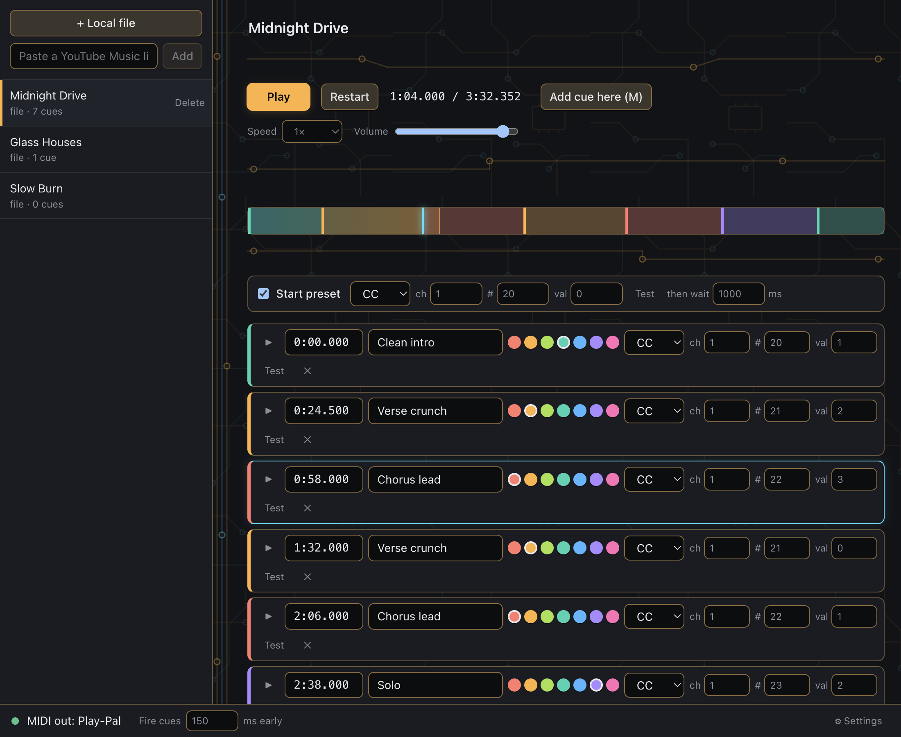

# Play Pal

Play along with a track while the app switches your Neural DSP presets for you.



1. Add a track: **+ Local file**, or paste a YouTube Music link (sign in once in the embedded page; the session is remembered).
2. Play it and press **M** (or "Add cue here") where a preset should change. Set the MIDI CC/Note each cue sends. **Test** sends it now.
3. Next time, open the track from the list and hit Play. Cues fire on their own, also after seeking or looping.

The app opens a virtual MIDI port named **Play Pal**. In your DAW or standalone plugin, enable it as a MIDI input next to the midi-controller's port.

## Using it

- **Timeline.** The track's waveform is recorded as it plays (so it fills in over the first listen and is kept after that), split into bass, low-mid, mid and high bands; pick **Mix** or one band to see where hits and sections fall. Click or drag on the waveform to seek; cues sit on it as markers, moved by their handles below it (or jump to one with its "Jump here" button in the cue list). Scroll to zoom at the pointer, scroll sideways to pan, **Follow** keeps the playhead in view.
- **Start preset.** A track can send a preset when playback starts from the beginning and wait a moment (default 1 s) for it to load before the music begins.
- **Panel.** Local files show a visualizer (Bars, Scope, Radial, Sparks) or nothing. YouTube Music tracks can show the video, a visualizer or nothing; the video keeps playing underneath when hidden. Drag the divider under the video to resize it.
- **Volume** is remembered per track.
- **Settings** (⚙ in the status bar): colour scheme, output device (remembered by name; falls back to the system default while unplugged), a limiter for YouTube Music's sudden loud bursts, and backups.

Tips: "Fire cues N ms early" covers preset load time. Put cues in gaps between phrases; some presets glitch while loading. Slowing a track down keeps cues aligned to track time. Animations pause while the window is behind your DAW, and cues keep firing on time.

## Keys

Active when no text field is focused.

| Key | Action |
| --- | --- |
| **Space** | play / pause |
| **M** | add a cue at the playhead |
| **←** / **→** | skip back / forward 10 s (repeated taps add up, then one seek) |
| **↑** / **↓** | volume up / down |
| **+** / **−** / **0** | zoom the timeline in / out / show the whole track |

## Your data

Everything lives in `~/Library/Application Support/play-pal/`:

- `library.json`: tracks, cues and settings (local file tracks store their path, so moving the file breaks that track).
- `backups/`: dated copies, made at each start, now and then while you edit, before a restore, and whenever the library file could not be read. Settings → Backups restores one (a second click confirms) or imports a library file of any age.
- `waveforms/`: the recorded waveforms. Safe to delete; they are recorded again as tracks play.

## Install as an app

```bash
tools/install.sh --open     # builds, ad-hoc signs, copies Play Pal.app to /Applications, opens it
```

Apple Silicon only. Re-run it after code changes to update the installed copy. The icon lives in `build/` (regenerate with `python3 tools/make-icon.py`). The installed app and the dev version share one data folder and a single-instance lock, so quit one before starting the other.

Development: see `CLAUDE.md`.
